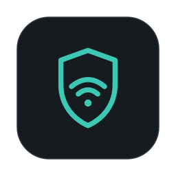

<p align="center">
  
</p>

<h1 align="center">WiSecured</h1>

<p align="center">
  <b>Public Wi-Fi, secured.</b><br>
  A macOS menu bar app that checks whether the network you're on is tampering with your connection.
</p>

<p align="center">
  
  
  
  
</p>

You join a café, hotel or airport Wi-Fi. Is it honestly passing your traffic through, or is it changing DNS answers, presenting fake certificates, pretending to be the router or modifying web pages? WiSecured checks within seconds of joining, keeps watching while you stay connected, and shows **one verdict** in the menu bar:

| Shield | Verdict | Means |
|---|---|---|
| 🟢 | **Looks safe** | No tampering found |
| 🟡 | **Be careful** | Open network, a login page, a company proxy, leftover routes… |
| 🔴 | **Don't trust this network** | Tampering found — don't log in to anything here |
| ⚪ | **Checking / no network** | |

Click the shield for the details: each check says **what was seen**, **what it most likely means** (including the harmless explanation when there is one) and **what to do**.

## The 10 checks

| # | Check | Catches |
|---|---|---|
| 1 | **Captive portal** | A login page between you and the internet (shown as info, never as danger) |
| 2 | **DNS interception** | The network secretly answering DNS questions meant for other servers |
| 3 | **DNS answers** | Fake answers sending you to fake sites — compared with encrypted DNS (Quad9, Cloudflare as backup). Blocked names (ad-blockers, filters) show as "Filtered", not as an attack |
| 4 | **DNSSEC** | A network that answers in place of a validating resolver |
| 5 | **Certificates** | Fake HTTPS certificates. A trusted-but-added authority (company proxy, security software) is yellow, not red |
| 6 | **Router identity** | Something pretending to be the router: its hardware address changes, or is shared by two addresses. Watched every 5 seconds |
| 7 | **Network DNS server** | A rogue server handing out its own DNS — and DNS set by hand on the Mac (normal if you did it; DNS-changer malware does the same) |
| 8 | **Page integrity** | Web pages modified in transit, or the switch to HTTPS stripped |
| 9 | **Wi-Fi security** | Open (no password) or broken (WEP) networks |
| 10 | **Routing health** | Dead or conflicting routes, e.g. leftovers from a VPN set up on another network (read-only) |

**VPN-aware:** the network tests are pinned to the Wi-Fi (or Ethernet) interface, so a VPN or split-tunnel routes don't hide the network being judged. The dropdown shows "VPN on" when a tunnel is up.

Full checks run when you join a network, every 15 minutes, and on **Check now**. Right-click the shield for a short menu (Check now, Settings, About, Quit).

## Privacy and security

- **Only looks at your Mac's own connection.** It never scans other devices and never reads anyone's traffic.
- **Read-only.** It never changes a setting or a route, and needs no admin rights or helper tools.
- **Local.** No account, no cloud, no telemetry, no analytics.
- **No third-party dependencies.** Apple frameworks only.
- **Outside contacts — the test lookups and nothing else** (also listed in Settings › About & privacy):
  - `captive.apple.com`, `detectportal.firefox.com` — login-page and page-integrity tests (plain HTTP)
  - `www.apple.com` — checks that the switch to HTTPS is kept
  - `9.9.9.9` / `1.1.1.1` — encrypted DNS (DoH) used as the reference, reached by IP so DNS filters can't block it; plain DNS for the DNSSEC test (`dnssec-failed.org`)
  - `192.0.2.53` — a reserved test address where nothing lives (any answer = interception)
  - `www.apple.com`, `www.google.com`, `www.cloudflare.com`, `www.wikipedia.org`, `github.com` — certificate check (connects, sends nothing)
  - your network's / your Mac's own DNS server — the same test names

### Permissions it asks for

| Permission | Why | Without it |
|---|---|---|
| **Location** | macOS only shows Wi-Fi names and security types to apps with Location permission. Your location itself is never used or stored | Checks still run; network name and Wi-Fi security are unknown |
| **Local Network** | To ask your network's DNS server and read your router's address | DNS-answer and router checks can't run |
| **Notifications** | One alert when a network turns red | Menu bar colour only |

## Install

1. Download the latest `WiSecured-<version>.dmg` from [**Releases**](https://github.com/dan-robotics/wisecured/releases/latest) and, optionally, check it: `shasum -a 256 WiSecured-*.dmg` against `SHA256SUMS.txt`.
2. Open the DMG and drag **WiSecured** onto **Applications**.
3. First launch: the app is ad-hoc signed, not notarized, so macOS blocks it once. Open it, then **System Settings › Privacy & Security › Open Anyway**.
4. Allow **Location**, **Local Network** and **Notifications** when asked. A shield appears in the menu bar.

Prefer not to run a downloaded binary? Build it yourself:

```bash
git clone https://github.com/dan-robotics/wisecured.git
cd wisecured
swift test        # 24 tests: every check's outcomes from simulated readings (no network)
./build.sh        # → dist/<version>-<timestamp>/WiSecured.app + dist/WiSecured-<version>-<timestamp>.dmg
```

Needs the Xcode command line tools with Swift 6.

## What it can't do

- **See a purely passive listener.** On an open network someone can listen without changing anything; WiSecured can only warn that the network is open.
- **Catch an attacker who targets only some sites, some of the time**, between checks.
- **Always tell a malicious network from an over-eager filter** — it explains both possibilities instead of guessing.

## Status and roadmap

**Early release (0.2.1).** Tested on a MacBook Pro M1 Pro, macOS 27.0.1: at home (with a DNS filter), on an iPhone hotspot and with a VPN connected. **Not yet tested on real public Wi-Fi** — reports welcome.

Planned:
- **Network memory** — "trust this network", and warnings when a known network changes (same name but a different access point or weaker security: evil-twin hints).
- **Switch to your hotspot** — one click when a network looks wrong, and back again.

## Project layout

```
Package.swift
Sources/CNetInfo/          C: the Mac's own address table (router identity) + routing table, read-only
Sources/WiSecuredCore/     the checks (pure functions), network tests, verdict rules
Sources/WiSecuredUI/       menu bar shield, dropdown, settings, scheduling, notifications
Sources/WiSecured/         app entry point
Tests/WiSecuredCoreTests/  simulated-reading tests
tools/make-icon.swift      draws the app icon
build.sh                   builds the .app + DMG
```

## License

[MIT](LICENSE) © 2026 Daniel Andries
